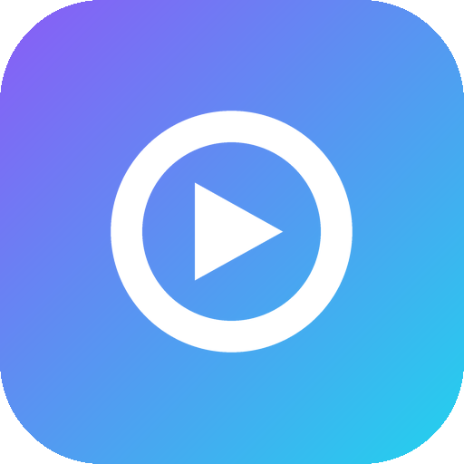
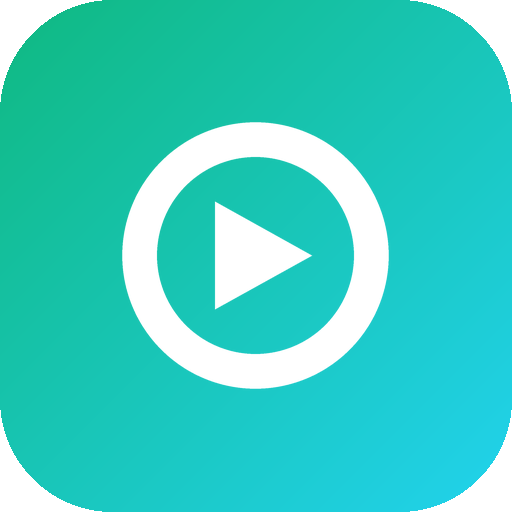

# TVO — Android TV, Android et iPhone

  

Appli qui réunit tes catalogues de films et séries et tes add-ons dans une seule interface.

## Fonctions
- Écran « Qui regarde ? » avec plusieurs profils (liste et progression séparées)
- Accueil avec grande bannière qui suit la sélection, rangées d'affiches, catégories
- Continuer à regarder, Ma liste, Films, Séries, Recherche avec clavier à l'écran
- Fiches détaillées, saisons et épisodes, épisodes déjà vus
- Système d'add-ons compatible Stremio/Nuvio (ajout par URL ou depuis le téléphone via QR code)
- Lecteur ExoPlayer : pistes audio et sous-titres, reprise, heure de fin, épisode suivant automatique
- Lecteur externe en option (VLC, Just Player…)
- Mise à jour automatique depuis les versions GitHub

## Installer
Onglet **Releases**, puis :
- **TV / box Android** : `TVO-TV-1.0.x.apk` (Downloader, Send Files to TV ou clé USB). Les mises à jour se proposent toutes seules.
- **Téléphone Android** : `TVO-Mobile-1.0.x.apk`.
- **iPhone** : `TVO-iOS-1.0.x.ipa`, à installer avec ESign ou KSign.

Le code de la TV est à la racine (Kotlin, Compose for TV, ExoPlayer). Celui du téléphone et de l'iPhone est dans `mobile/` (Capacitor), avec un design tactile différent.

## Compilation
Chaque envoi sur `main` lance le workflow GitHub Actions qui compile l'APK et publie une version.

TVO n'héberge et ne fournit aucun contenu : les vidéos viennent des add-ons ajoutés par l'utilisateur.
